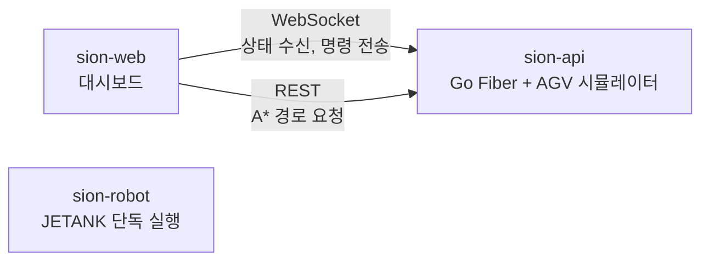

# Sion Robot

> Jetson 기반 AGV 제어 코드

Python 3.12 · A* · 멀티스레드 · pytest

## 개요

Sion은 LoL 챔피언 사이온의 궁극기(목표를 향한 직선 돌진)를 Jetson 기반 AGV로 옮긴 프로젝트다. AGV는 맵에서 적을 찾아 장애물을 피해 접근한 뒤 직선 구간에서 가속해 돌진한다.

이 저장소는 AGV에서 도는 제어 코드다. 격자 맵에서 경로를 계획하고, 바퀴 속도로 위치를 추정하며 경로를 따라가고, 적에게 도달하면 회전한 뒤 서보 팔로 공격 동작을 한다.

## 시스템 구성

Sion은 데모 전용으로 동작한다. 대시보드는 sion-api에 붙고, sion-api 안의 시뮬레이터가 AGV 역할을 한다. 이 저장소의 코드는 JETANK에서 단독으로 돌며 서버와 연결되지 않는다.



| 저장소 | 역할 |
|---|---|
| [sion-web](https://github.com/tolelom/sion-web) | 관제 대시보드 |
| [sion-api](https://github.com/tolelom/sion-api) | 대시보드용 WebSocket·REST 서버. 내장 시뮬레이터가 AGV 역할을 한다 |
| sion-robot | JETANK 제어. 경로 계획, 경로 추종, 적 돌진(이 저장소). 서버와 연결되지 않는다 |

## 기능

- 경로 계획: 장애물 팽창, A*, 경로 평활화, 적 목표일 때 직선 돌진 구간 추가
- 적 추적용 A* 변형: 회전을 줄이는 경로 선호
- 경로 추종: 일정 속도 주행, 돌진 구간 가속, 취소 요청에 반응
- 위치 추정: 명령한 선속도·각속도로 계산하는 추측 항법
- 적 도달 동작: 회전 후 서보 팔 공격, 초기 자세 복귀
- 자동 모드: 일정 간격으로 맵 안의 무작위 목표 선정
- 하드웨어가 없으면 `DummyRobot`으로 자동 전환(로그만 남기고 모터는 움직이지 않음)

## 구조

| 경로 | 책임 |
|---|---|
| `controller.py` | 진입점. 메인 루프, 카메라 스레드, 이동 스레드 관리 |
| `state.py` | 스레드 간 공유 상태(lock 기반) |
| `mode_manager.py` | 자동/수동 모드 전환, 무작위 목표 선정 |
| `path_planner.py` | 팽창 → A* → 평활화 → 돌진 구간 파이프라인 |
| `astar.py` | 일반 A*와 적 추적용 A* |
| `path_utils.py` | 시야선 검사, 평활화, 팽창, Bresenham, 돌진 구간 |
| `follow_path.py` | 위치 추정과 경로 추종, 적 도달 동작 |
| `hardware.py` | 로봇 인터페이스와 JETANK·더미 구현 |
| `map_loader.py` | JSON 맵 로드, 셀↔월드 좌표 변환 |
| `config.py` | 속도, 팽창 반경, 서보 각도 등 상수. 맵 경로는 저장소 기준 절대 경로 |
| `scripts/` | 보조 스크립트: 맵·경로 시각화(`show_map`, `show_path`), 맵 생성(`generate_smallroom_map`), 모터 캘리브레이션(`calib_motion`), 모터 동작 확인(`motor_smoke_test`) |
| `tests/` | pytest 단위·통합 테스트. `conftest.py`의 `make_map`으로 문자열 격자에서 맵을 만든다. 하드웨어 없이 돈다 |
| `tests/fixtures/pathfinding-cases.json` | sion-api `contract/pathfinding-cases.json`의 복사본. `astar_normal`과 sion-api A*가 같이 통과해야 하는 케이스 |

## 실행

Python 3.12가 필요하다. 실제 AGV에서는 `jetbot`, `SCSCtrl` 패키지가, 카메라 스레드에는 OpenCV가 필요하다.

```bash
git clone https://github.com/tolelom/sion-robot.git
cd sion-robot

pip install -r requirements-dev.txt opencv-python
python controller.py
```

`jetbot`이나 `SCSCtrl`을 import하지 못하면 `DummyRobot`으로 넘어가므로 데스크톱에서도 실행할 수 있다. OpenCV가 없으면 카메라 스레드만 건너뛴다. 맵 파일은 `config.py`의 `MAP_FILE`로 정한다.

`scripts/`는 루트 모듈을 import하므로 저장소 루트에서 `python -m`으로 실행한다.

| 명령 | 용도 |
|---|---|
| `python controller.py` | 제어 루프 실행 |
| `python -m pytest` | 테스트 |
| `python -m scripts.show_map [맵 파일]` | 맵 시각화 |
| `python -m scripts.show_path` | `MAP_FILE`의 시작점→첫 적 경로 시각화 |
| `python -m scripts.generate_smallroom_map` | `map_smallroom_60x60.json` 재생성 |
| `python -m scripts.calib_motion {drive\|turn} 속도 ...` | 모터 캘리브레이션(실기). 예: `drive 0.2 0.4 0.6` |
| `python -m scripts.motor_smoke_test` | 1초 전진 후 정지(실기) |

CI는 push마다 pytest를 커버리지 하한과 함께 돌린다.

A* 케이스는 sion-api가 주인이다. 바뀌면 복사해 온다.

```bash
cp ../sion-api/contract/pathfinding-cases.json tests/fixtures/
# 또는
curl -fsSL https://raw.githubusercontent.com/tolelom/sion-api/main/contract/pathfinding-cases.json -o tests/fixtures/pathfinding-cases.json
```

sion-api는 양옆 칸이 모두 비어야 대각으로 움직이고 이 저장소는 막힌 모서리도 대각으로 지난다(팽창한 맵에서 계획한다). 결과가 갈리는 케이스는 `corner_cutting_expected`에 이 저장소의 기대값이 있다.
