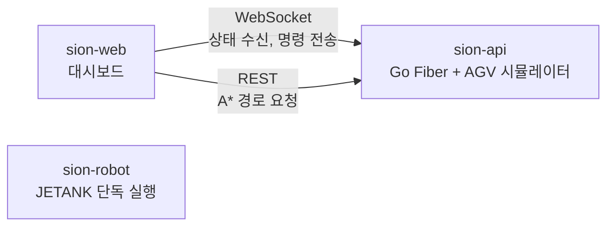

# Sion Robot

> Jetson 기반 AGV 제어 코드

Python 3.12 · jetbot · SCSCtrl · OpenCV · pytest



Sion은 LoL 챔피언 사이온의 궁극기(목표를 향한 직선 돌진)를 Jetson 기반 AGV로 옮긴 프로젝트입니다. AGV는 맵에서 적을 찾아 장애물을 피해 접근한 뒤 직선 구간에서 가속해 돌진합니다. 데모에서는 [sion-api](https://github.com/tolelom/sion-api) 안의 시뮬레이터가 AGV 역할을 하고, 실제 로봇 코드인 sion-robot은 JETANK에서 단독으로 돌며 서버와 연결되지 않습니다.

## 기능

- 장애물을 피하는 경로 계획, 목표가 적이면 끝에 직선 돌진 구간 추가
- 적을 쫓을 때 회전이 적은 경로 선호
- 일정 속도 경로 추종, 돌진 구간 가속, 도중 취소
- 명령한 선속도·각속도로 위치 추정
- 적에게 도달하면 회전 후 서보 팔 공격, 초기 자세 복귀
- 자동 모드에서 일정 간격으로 맵 안의 무작위 목표 선정
- 하드웨어가 없으면 `DummyRobot`으로 전환(로그만 남기고 모터는 그대로)

## 시작하기

Python 3.12가 필요합니다. 실제 AGV에서는 `jetbot`, `SCSCtrl` 패키지가, 카메라 스레드에는 OpenCV가 필요합니다.

```bash
git clone https://github.com/tolelom/sion-robot.git
cd sion-robot
python controller.py
```

`jetbot`이나 `SCSCtrl`을 불러오지 못하면 `DummyRobot`으로, OpenCV가 없으면 카메라 스레드 없이 돌아 데스크톱에서도 실행됩니다. 맵 파일은 `sion_robot/config.py`의 `MAP_FILE`로 정합니다.

## 문서

| 문서 | 내용 |
|---|---|
| `ARCHITECTURE.md` | 저장소 역할과 코드 지도 |

## 기여

개발 명령, 보조 스크립트, A* 케이스 갱신 절차는 `CONTRIBUTING.md`에 있습니다.
